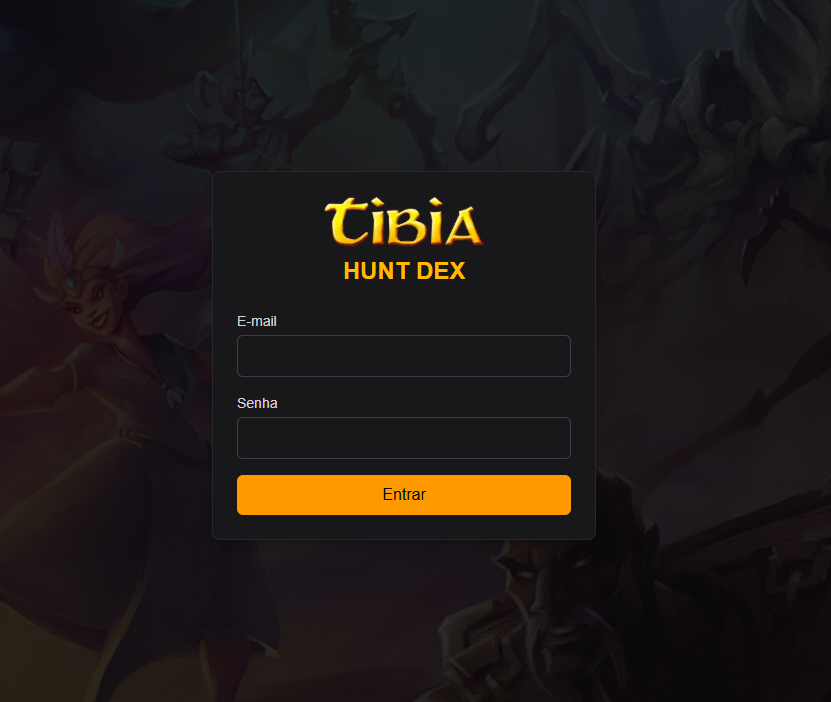
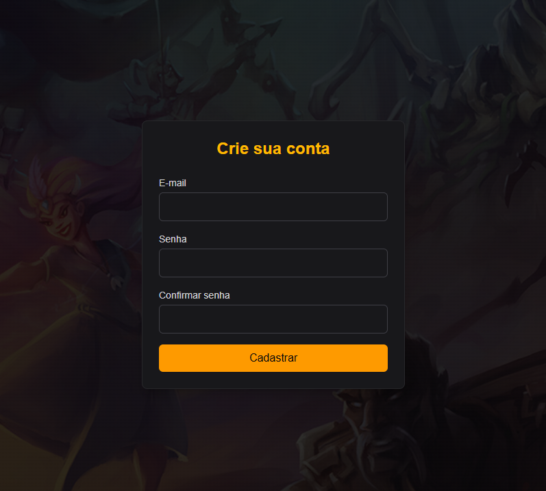
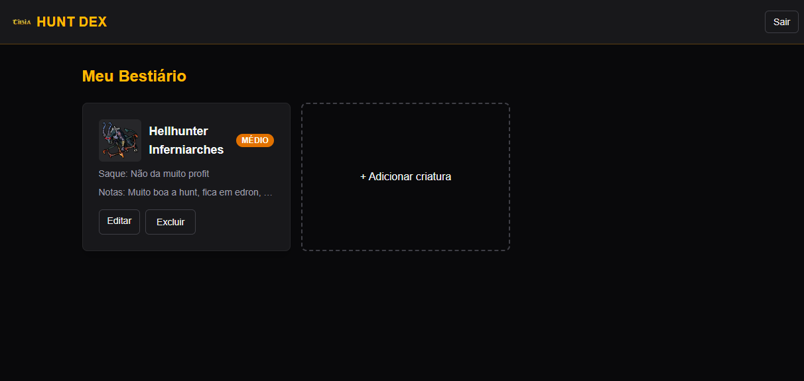
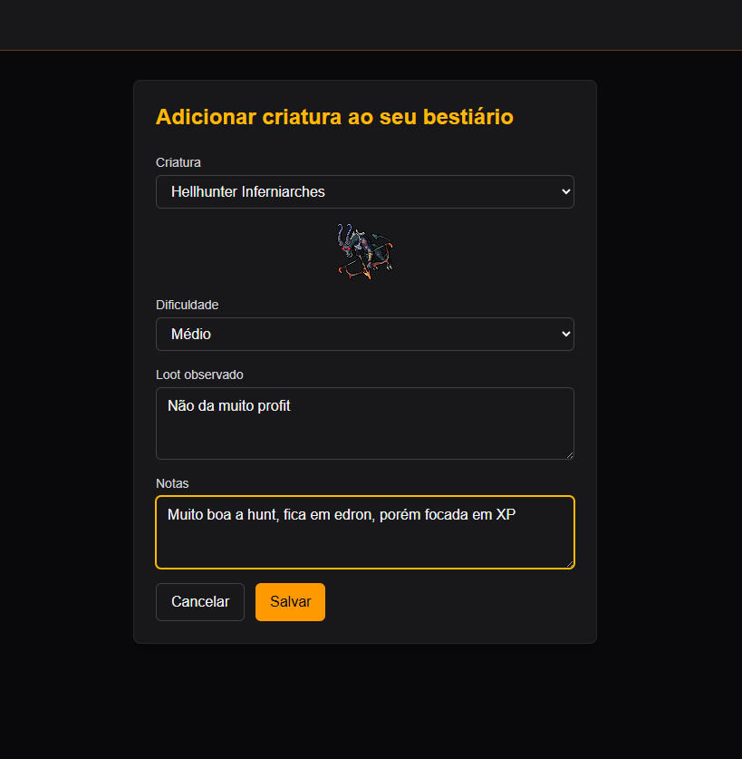
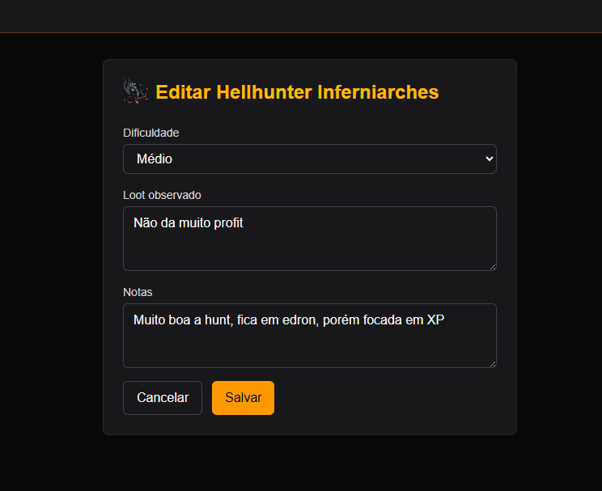

# Hunt Dex

Hunt Dex é um bestiário pessoal de Tibia: um projeto full-stack individual para o trabalho final de XDES03 (Programação Web) da UNIFEI. Um usuário autenticado registra suas próprias anotações sobre criaturas do MMORPG Tibia — dificuldade percebida, loot observado e estratégia de combate — enquanto os dados de referência das criaturas (nome, imagem, descrição) são obtidos em tempo real da API pública [TibiaData](https://docs.tibiadata.com/).

## Tecnologias utilizadas

- **Frontend**: Next.js 14 (App Router, TypeScript), Tailwind CSS v4 (componentes de UI escritos à mão, sem biblioteca de componentes)
- **Backend**: NestJS, TypeORM, SQLite
- **Autenticação**: JWT armazenado em cookie `httpOnly`, rotas protegidas por Middleware do Next.js
- **API externa**: [TibiaData API](https://docs.tibiadata.com/) (com proxy pelo backend)
- **Idioma da UI**: pt-BR (todo o texto estático do frontend está em português; mensagens de erro do backend estão em inglês)

> **Nota**: o cookie JWT não usa `secure: true` porque este projeto roda em HTTP puro localmente e não tem deploy em produção exigido pelo trabalho; um deploy real em produção precisaria de HTTPS e `secure: true`.

## Executando localmente

```bash
# Terminal 1
cd backend
npm install
npm run start:dev   # http://localhost:3333

# Terminal 2
cd frontend
npm install
npm run dev          # http://localhost:3000
```

Depois acesse `http://localhost:3000/register` para criar uma conta.

## Screenshots

| Login | Cadastro |
| --- | --- |
|  |  |

| Dashboard | Adicionar criatura |
| --- | --- |
|  |  |

| Editar entrada |
| --- |
|  |

## Integrantes

- Gabriel Mussolini 2020007960 — [github.com/gabrielmussolini984](https://github.com/gabrielmussolini984)
